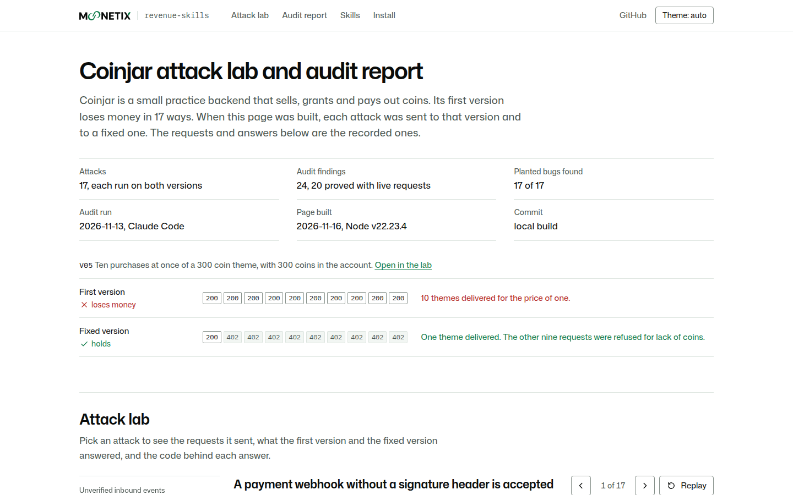

# revenue-skills

**Agent skills that find and fix the bugs that cost your app money: a money-path audit where every finding carries a proof, and skills that build webhooks, ledgers, credits, refunds, referrals and payouts correctly.**

[](https://github.com/moonetix/revenue-skills/actions/workflows/ci.yml)
[](LICENSE)
[](https://agentskills.io)
[](#the-skills)
[](package.json)

Maintained by [Moonetix](https://moonetix.com), an affiliate network.

[](https://moonetix.github.io/revenue-skills/)

**[Open the live demo](https://moonetix.github.io/revenue-skills/)**: one attack for every bug planted in a practice app, each sent to the broken and to the fixed version, and the full report an agent wrote with the audit skill.

They work with Claude Code, Codex, Cursor, Gemini CLI, GitHub Copilot, OpenCode, Goose, Amp and any other agent that reads the [Agent Skills](https://agentskills.io) format.

## What it catches

Each of these looks fine in a demo and costs money in production:

- **A provider retries a webhook,** and the user is credited three times for one payment.
- **A webhook skips the signature check when the header is missing,** and anyone can post a "paid" event for an order they never paid.
- **Ten purchases arrive at the same moment** against a balance that covers one, and all ten are delivered.
- **A refund or a chargeback leaves the credits in the account,** so the buyer keeps what they got and the money is gone.
- **A payout call times out and the code marks it failed,** returns the coins, and the user cashes out again while the first payment arrives.
- **A referral bonus is paid at sign-up,** and one person collects it a hundred times with throwaway accounts.

## Try it in a minute

Install all ten skills into the agent you use:

```bash
npx skills add moonetix/revenue-skills
```

Then ask, in the project you want checked:

> Audit this project for ways users could get free credits or be paid twice.

The audit writes a report with a file, a line, the quoted code and a proof for every finding. The start of a real one, from the [example audit](examples/coinjar-audit/REPORT.md) of the practice app in this repository:

> **24 findings:** 11 critical, 6 high, 6 medium, 1 low.
>
> | ID | Severity | Class | Finding | Where | Proof |
> | --- | --- | --- | --- | --- | --- |
> | MA-01 | critical | Unverified inbound events | A Paylane webhook sent without a signature header is accepted and credits the order | `routes/webhooks.mjs:8` | probe |
> | MA-07 | critical | Races on a balance | Parallel purchases all succeed and the balance is charged for one | `routes/wallet.mjs:18` | probe |
> | MA-13 | critical | Refunds and reversals | Refund and dispute events from Paylane are acknowledged and the coins stay | `routes/webhooks.mjs:17` | probe |

And from the proof of MA-01:

> With the header dropped it answered 200 and the balance rose from 0 to 500 for an order nobody paid.

## Pick by situation

Ask in plain words; the agent picks the skill from its description. If it does not, name the skill in the prompt.

| Your situation | Skill | Prompt to start with |
| --- | --- | --- |
| I sell credits in an AI app | [`add-usage-credits`](skills/add-usage-credits/) | `Charge credits for every AI request: hold the most it can cost before the model call, charge what the provider reports after it, and never charge twice for a retry or a cut stream.` |
| I take payments with Stripe, Paddle or Lemon Squeezy | [`build-webhook-endpoint`](skills/build-webhook-endpoint/), then [`handle-refunds-and-reversals`](skills/handle-refunds-and-reversals/) | `Add the Stripe webhook that credits paid orders exactly once, then make refunds and disputes take the credits back.` |
| I sell in-app purchases on Apple or Google | [`build-webhook-endpoint`](skills/build-webhook-endpoint/), then [`handle-refunds-and-reversals`](skills/handle-refunds-and-reversals/) | `Grant App Store and Google Play purchases from their server notifications, and take them back on refunds and revocations.` |
| I pay users out | [`add-payouts`](skills/add-payouts/) | `Add cash-outs that can never pay twice, with a minimum, daily limits and a hold on new earnings.` |
| I run a rewards app or an offerwall | [`add-offerwall`](skills/add-offerwall/), [`design-reward-economy`](skills/design-reward-economy/) | `Add an offerwall with a postback that credits each conversion once and handles reversals, then check that our coin rate and bonuses do not lose money.` |
| I want referrals | [`add-referral-program`](skills/add-referral-program/) | `Add a referral program that pays only after the friend's first purchase and cannot be farmed with second accounts.` |
| I give sign-up bonuses or trials | [`guard-signups`](skills/guard-signups/) | `Give new accounts a welcome bonus and a free trial without letting duplicate and throwaway accounts farm them.` |
| Every feature writes the balance column directly | [`build-ledger`](skills/build-ledger/) | `Move every balance change onto a ledger with a history per user and a reconciliation check.` |
| Audit my existing code | [`money-audit`](skills/money-audit/) | `Audit this project for ways users could get free credits or be paid twice.` |

### Start in your agent

`npx skills add moonetix/revenue-skills` asks which agents to install into. Each agent reads skills from its own project folder; copying a folder under [`skills/`](skills/) there works as well.

| Agent | Other ways to install | Skills folder in a project |
| --- | --- | --- |
| Claude Code | `/plugin marketplace add moonetix/revenue-skills`, then `/plugin install revenue-skills@revenue-skills` | `.claude/skills/` |
| Codex | `codex plugin marketplace add moonetix/revenue-skills`, then pick it under `/plugins` | `.agents/skills/` |
| Cursor | | `.agents/skills/` |
| Gemini CLI | `gemini extensions install https://github.com/moonetix/revenue-skills` | `.agents/skills/` |
| GitHub Copilot | | `.agents/skills/` |
| OpenCode | | `.agents/skills/` |
| Goose | | `.goose/skills/` |
| Amp | | `.agents/skills/` |

The [installer's agent list](https://github.com/vercel-labs/skills/blob/main/docs/agents.md) has the other agents and the global folders.

## Measured

**The builder skills, in trials.** A fresh coding agent (Claude Opus 5.5 running as a Claude Code agent, one non-interactive session per skill) got a starter app, a plain request and the one skill. An automated checker then attacked what it built.

| Skill | Checks | First-run result | Notes |
| --- | --- | --- | --- |
| `build-webhook-endpoint` | 20 | 20/20 | |
| `handle-refunds-and-reversals` | 15 | 15/15 | |
| `add-offerwall` | 14 | 14/14 | |
| `guard-signups` | 14 | 14/14 once its newly required secret was supplied | The agent made a keyed-hash secret mandatory and flagged it as a deploy step. The task's environment did not include it, so the run with that environment alone did not start. |
| `build-ledger` | 12 | 12/12 | |
| `add-referral-program` | 12 | 12/12 | |
| `add-usage-credits` | 10 | 10/10 | |
| `design-reward-economy` | 8 | 8/8 | |
| `add-payouts` | 16 | 13/16 | The agent added a waiting window that stopped a manual resolve right after an unknown outcome. The skill now says that lookups and repeats with the same key are safe and that a manual resolve must ask the provider right away. A second fresh run with the fixed skill: 16/16. |

Each result was the same in three checker runs. This is one agent and one model, with one run per skill (two for `add-payouts`). The checks cover what can be seen from outside the app; each trial's `RUBRIC.md` lists the rules left to code review. The starter apps were written for this repository. [`trials/`](trials/) has the tasks, the checkers and how to run them with your own agent.

**The audit, on two codebases.** `money-audit` is measured separately, with one run on each:

| Target | Result |
| --- | --- |
| [`playground/vulnerable/`](playground/vulnerable/), the practice app | With Claude Code: all 17 planted bugs found, each matched to a different finding. 24 findings, all accepted by the validator: 20 proved with requests from the probe, 4 with code traces. 23 point at a planted bug; the other one was a real weakness the key does not list. The report is in [`examples/coinjar-audit/`](examples/coinjar-audit/). |
| [referral-engine](https://github.com/moonetix/referral-engine) v1.0.0, a published library | Three ways for a payout to exceed the balance, one high and two medium. All three were fixed in referral-engine 1.0.1 through [pull request #1](https://github.com/moonetix/referral-engine/pull/1). The run is in [`examples/referral-engine-audit/`](examples/referral-engine-audit/). |

The practice app was written for this repository and the skill references alongside it. In the practice app run, one probe example in `unverified-events.md` still showed a `debug=1` bypass that matches one of the planted bugs (1.1.0 removed it). Read it as an end to end check, not as a benchmark on unfamiliar code. referral-engine is a library by the same maintainer: one library, one run. `npm run check:example` validates and scores the first audit, and shows the tests the agent wrote for referral-engine failing on 1.0.0 and passing on 1.0.1. Results vary with the agent and the model.

## The skills

**Find**

| Skill | What it does |
| --- | --- |
| [`money-audit`](skills/money-audit/) | Maps every path where value enters, moves or leaves, hunts ten classes of money bugs, proves each finding, and writes a validated report. Also answers focused questions about one handler or one change. |

**Build, for any app that charges, credits or pays out**

| Skill | What it does |
| --- | --- |
| [`build-ledger`](skills/build-ledger/) | An append-only ledger with a cached balance: idempotent entries, debits that cannot overdraw, reconciliation, and a migration path from a mutable balance column. |
| [`build-webhook-endpoint`](skills/build-webhook-endpoint/) | An endpoint for signed server-to-server events: raw-body verification, replay protection, content checks and exactly-once effects. References for Stripe, Paddle, Lemon Squeezy, PayPal, RevenueCat, the App Store and Google Play. |
| [`handle-refunds-and-reversals`](skills/handle-refunds-and-reversals/) | Refunds, chargebacks and reversed conversions take back what the original granted, exactly once, with an explicit rule for balances already spent. Includes the refund and dispute events of the same seven providers. |
| [`add-usage-credits`](skills/add-usage-credits/) | Prepaid credits for metered features such as AI generations or API calls, with reserve, commit and release for work whose cost is known only afterwards. Covers token pricing and streamed calls for OpenAI, Anthropic and Gemini. |
| [`add-payouts`](skills/add-payouts/) | Withdrawals as a state machine: funds reserved first, the provider called with an idempotency key, limits, holds and reconciliation. |
| [`add-referral-program`](skills/add-referral-program/) | Referral rewards that are paid once, after a verified qualifying event, and taken back when that event is reversed. |
| [`guard-signups`](skills/guard-signups/) | Bonuses, trials and promo codes protected from fake and duplicate accounts, with an explainable score and a review outcome that does not lock real users out. |

**Build, for rewards apps and sites**

| Skill | What it does |
| --- | --- |
| [`add-offerwall`](skills/add-offerwall/) | An offerwall in a website, app, game or community: a server-built signed link, and a postback endpoint that credits each transaction once and honors reversals. |
| [`design-reward-economy`](skills/design-reward-economy/) | The numbers behind a rewards currency: rate, user share, bonus budget, payout threshold and hold periods, checked by a bundled script that prints the margin, the break-even points and every rule the numbers break. |

Every builder skill that writes code shows its core pattern in Next.js, Express, Django, Laravel and Rails. Each builder skill ends with a verification step: tests in your project's own framework, and probe commands with the result to expect. `design-reward-economy` verifies with its economy check instead.

## Install

With the [skills installer](https://github.com/vercel-labs/skills), into whichever agent you use. The installer needs Node 22.20 or newer; the scripts inside the skills run on Node 20 or newer.

```bash
npx skills add moonetix/revenue-skills
```

One skill only, or see what is available first:

```bash
npx skills add moonetix/revenue-skills --skill money-audit
```

```bash
npx skills add moonetix/revenue-skills --list
```

As a Claude Code plugin:

```
/plugin marketplace add moonetix/revenue-skills
/plugin install revenue-skills@revenue-skills
```

As a Codex plugin: `codex plugin marketplace add moonetix/revenue-skills`, then pick it under `/plugins`.

As a Gemini CLI extension: `gemini extensions install https://github.com/moonetix/revenue-skills`.

Or copy any folder under [`skills/`](skills/) into your agent's skills folder (see [Start in your agent](#start-in-your-agent)). Each skill is self-contained.

## How it works

**The audit** maps where value enters, moves and leaves the app, then hunts ten classes of money bugs one at a time, from unverified payment events and duplicate credits to payout controls and the audit trail. The [class table in the skill](skills/money-audit/SKILL.md#2-hunt-one-class-at-a-time) lists them with the question each answers, and each class has a reference with the code shapes to look for, how to prove them, and the cases that look like bugs but are not: [`skills/money-audit/references/`](skills/money-audit/references/).

**The validator.** The audit writes `money-audit/findings.json` and runs the bundled validator on it before it reports anything. The validator checks that each quoted snippet is at the file and line it names, that every proof has its fields filled in, and that all ten classes are accounted for. It does not rerun a proof. This is what it prints when a finding cites code that is not there:

```console
$ node skills/money-audit/scripts/validate-findings.mjs money-audit/findings.json --root .
error: finding MA-03 location: snippet not found at routes/webhooks.mjs:20. The text is at line 8.
error: finding MA-07: proof.result must say what the run showed
error: coverage: class "payout-controls" is not accounted for

INVALID: 3 problems. Fix the report, do not delete the check.
```

**The probe** replays, races and tampers with requests against an app on your own machine, and reports how a balance moved. Ten purchases at once, against an account that can afford one:

```console
$ node skills/money-audit/scripts/probe.mjs race spend.json --parallel 10 --observe me.json
{
  "probe": "race",
  "request": "POST http://127.0.0.1:3000/api/spend",
  "edits": [],
  "sent": 10,
  "statuses": {
    "200": 10
  },
  "samples": [
    {
      "status": 200,
      "body": "{\"item\":\"theme\",\"balance\":0}"
    }
  ],
  "ms": 38,
  "observed": {
    "path": "balance",
    "before": 300,
    "after": 0,
    "delta": -300
  }
}
```

All ten succeeded, ten items were delivered, and the balance fell by the price of one. This is real output from the practice app in this repository.

The probe is deliberately small. It edits JSON bodies only, keeps no cookies, and sends the same request each time apart from a per-request number, so some proofs need a test instead. [proving-findings.md](skills/money-audit/references/proving-findings.md#what-the-probe-cannot-do) lists its limits.

**The builder skills** read the project first, ask once about the decisions that belong to you (with a default for each), build in your stack, and end with tests and probe commands that show the money path holds.

## The practice app

[`playground/`](playground/) holds Coinjar, a small backend that sells, grants, moves and pays out virtual coins, in two versions:

- [`playground/vulnerable/`](playground/vulnerable/) works, and loses money in 17 ways.
- [`playground/fixed/`](playground/fixed/) has the same features with every one of those ways closed.

[`test/playground.test.mjs`](test/playground.test.mjs) contains one exploit per planted bug. Each must succeed against the vulnerable app and fail against the fixed one, on every commit.

To measure an audit by your own agent, copy `playground/vulnerable/` out of the repository, have the agent audit the copy, and score the result:

```bash
node playground/score.mjs path/to/copy/money-audit/findings.json
```

Details are in the [playground README](playground/README.md). The [answer key](playground/ANSWER-KEY.md) is a spoiler.

## Trials: measure your own agent

Each builder skill has a trial in [`trials/`](trials/): a starter app, the request a user would type, a checker that attacks the result, a reference solution that passes every check and a naive one that shows what the checks catch. Copy the starter out of the repository, install the one skill, give your agent the request, then run the checker on what it built:

```bash
node trials/add-payouts/check.mjs ../my-trial-folder
```

`npm run trials:validate` shows that every checker passes its reference solution and fails the naive one on the documented checks. The [trials README](trials/README.md) has the steps, the exact prompt and the results above in detail.

## Safety

- The audit reads code and probes only an app running on your machine. It does not change application code unless you ask for fixes.
- The probe refuses any target that is not a loopback address unless you name the host with `--allow-host`. It sends at most 20 requests in sequence or 50 at once, and does not follow redirects. It is a proof tool, not a load or scanning tool.
- The probe has limits that can hide a bug. It edits and reads JSON only, has no cookie jar, forms or CSRF tokens, and cuts response samples at 300 characters. `race` sends the same request each time, apart from `{{i}}`, the number of each request, so a PHP session lock, a shared idempotency key or a per-account cap can make a race look clear. In those cases the audit proves with a test in your project instead.
- Findings never contain secret values. When a live secret is found in code, the report says where it is and what it opens.
- Test only systems you own or are authorized to test.

## FAQ

**Does it send my code anywhere?** No. The skills are instructions and local scripts, and nothing in them uploads code or results. Your agent sends what it reads to its own model provider, as it does for any task.

**Which agents does it work with?** Any agent that reads the Agent Skills format. The [table above](#start-in-your-agent) lists the folders for Claude Code, Codex, Cursor, Gemini CLI, GitHub Copilot, OpenCode, Goose and Amp. The trials and the practice app audit were run with Claude Code.

**Does it need network access?** Only to install. The probe talks to 127.0.0.1 unless you name another host with `--allow-host`. The skills tell the agent to read a provider's current documentation where a scheme can change.

**What does it cost?** Nothing. It is MIT licensed, with no account and no service behind it. Your agent's usage is billed by its provider as usual.

## Contributing

```
skills/        ten skills, one folder each: SKILL.md, references/, scripts/, evals/
playground/    the practice app (vulnerable and fixed), answer key, scorer
trials/        one trial per builder skill: starter, task, checker, reference and naive solutions
examples/      two audits as the agent wrote them: the practice app, and referral-engine
test/          exploits against both apps, tests for the scripts, repository rules
scripts/       skill validation, shared-file sync, trial validation, the build of the demo page
site/          the demo page; its data is recorded from both apps at build time
```

```bash
npm test
```

```bash
npm run validate
```

```bash
npm run trials:validate
```

```bash
npm run check:example
```

Node 22.13 or newer for the tests, the practice app and the trials, Node 20 or newer for the scripts inside the skills. Nothing to install. [CONTRIBUTING.md](CONTRIBUTING.md) explains how to improve a skill, add a trial or add a bug to the practice app, and [AGENTS.md](AGENTS.md) holds the rules for changes. If the audit missed a bug you have seen in the wild, [tell us the shape of it](https://github.com/moonetix/revenue-skills/issues/new?template=missed-bug.yml). To report a vulnerability in the scripts, see [SECURITY.md](SECURITY.md).

## About

Moonetix is an affiliate network. Publishers add its offerwall to an app, game, website, bot or community, and users earn the publisher's own currency by completing offers. [moonetix.com](https://moonetix.com)

Libraries and data by the same maintainer that the builder skills can lean on: [referral-engine](https://github.com/moonetix/referral-engine), [signup-guard](https://github.com/moonetix/signup-guard), [reward-economy-kit](https://github.com/moonetix/reward-economy-kit), [affiliate-postback-macros](https://github.com/moonetix/affiliate-postback-macros), [datacenter-ip-ranges](https://github.com/moonetix/datacenter-ip-ranges), [offerwall-postback-handlers](https://github.com/moonetix/offerwall-postback-handlers), [offerwall-fraud-playbook](https://github.com/moonetix/offerwall-fraud-playbook).

## License

MIT. See [LICENSE](LICENSE).
